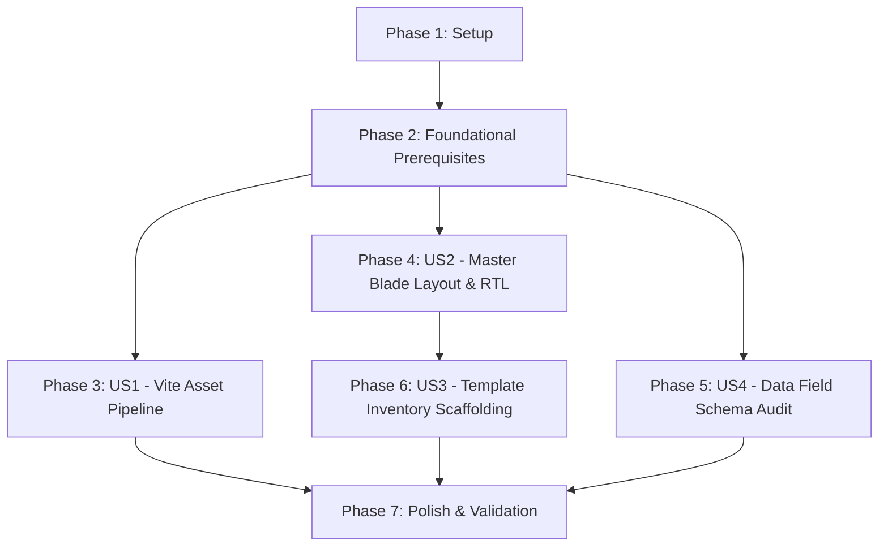

# Tasks: Phase 2 — UI Foundation: Static Pages → Blade

**Feature Branch**: `002-ui-foundation-blade`
**Spec**: [spec.md](./spec.md) | **Plan**: [plan.md](./plan.md)

---

## Phase 1: Setup (Shared Infrastructure)

**Purpose**: Initialize directory structures for self-hosted fonts, page-specific assets, and Blade view layouts.

- [x] T001 Create fonts directory `resources/fonts/cairo/` and place self-hosted Cairo WOFF2 font files (`cairo-v28-arabic-regular.woff2`, `cairo-v28-arabic-700.woff2`)
- [x] T002 [P] Create page-specific asset directory structure under `resources/css/pages/` and `resources/js/pages/`
- [x] T003 [P] Create views directory structure under `resources/views/layouts/`, `resources/views/partials/`, and `resources/views/components/`

---

## Phase 2: Foundational (Blocking Prerequisites)

**Purpose**: Core infrastructure that MUST be complete before ANY user story can be implemented.

- [x] T004 Configure `vite.config.js` to process master entrypoints (`resources/css/app.css`, `resources/js/app.js`) and modular page inputs (`resources/css/pages/*.css`, `resources/js/pages/*.js`)
- [x] T005 [P] Create Arabic localization translation files in `lang/ar/navigation.php`, `lang/ar/ui.php`, and `lang/ar/status.php` with key-value dictionaries for navigation and clinical UI
- [x] T006 Refactor `pre-views/shared-data.js` into ES module at `resources/js/shared-data.js` with explicit exports and bind `window.WCCMS` for legacy script compatibility

**Checkpoint**: Foundation ready - user story implementation can now begin.

---

## Phase 3: User Story 1 - Vite Asset Pipeline & Static Asset Migration (Priority: P1) 🚀 MVP

**Goal**: Process and bundle all static CSS/JS assets from `pre-views/` under Laravel's Vite build pipeline with 0 compilation errors.

**Independent Test**: Execute `npm run build` and verify `public/build/manifest.json` generates compiled production bundles without missing file or reference errors.

### Implementation for User Story 1

- [x] T007 [P] [US1] Create global stylesheet `resources/css/app.css` with `@font-face` Cairo rules, RTL resets, and base styling imported from `pre-views/custom.css`
- [x] T008 [P] [US1] Create core JavaScript entrypoint `resources/js/app.js` importing `resources/js/shared-data.js`
- [x] T009 [P] [US1] Migrate static page CSS files to `resources/css/pages/requests.css`, `resources/css/pages/registrations.css`, `resources/css/pages/reviews.css`, and `resources/css/pages/admin.css`
- [x] T010 [P] [US1] Migrate static page JS files to `resources/js/pages/requests.js`, `resources/js/pages/reviews.js`, and `resources/js/pages/admin.js`
- [x] T011 [US1] Execute `npm run build` and verify `public/build/manifest.json` asset generation without compilation errors

**Checkpoint**: User Story 1 fully functional — Vite build pipeline verified.

---

## Phase 4: User Story 2 - Master Blade Layout & First-Class Arabic/RTL Support (Priority: P2)

**Goal**: Create central master Blade layout (`layouts/app.blade.php`) enforcing `dir="rtl"`, `lang="ar"`, self-hosted Cairo Arabic typography, and shared partials (header, sidebar, footer).

**Independent Test**: Render a dummy view extending `layouts/app.blade.php` verifying native RTL orientation, Arabic typography, and shared navigation partials.

### Implementation for User Story 2

- [x] T012 [P] [US2] Create master layout `resources/views/layouts/app.blade.php` with `<html lang="ar" dir="rtl">`, Cairo typography font stack, `@vite` directives, and `@yield('content')`
- [x] T013 [P] [US2] Create header navbar partial `resources/views/partials/header.blade.php` using `__('navigation.header')` localization keys
- [x] T014 [P] [US2] Create sidebar navigation partial `resources/views/partials/sidebar.blade.php` rendering Phase 3-9 clinical module links via `__('navigation.sidebar')`
- [x] T015 [P] [US2] Create footer partial `resources/views/partials/footer.blade.php` with system status and Arabic copyright labels via `__('navigation.footer')`

**Checkpoint**: User Story 2 complete — Master layout and shared Arabic partials operational.

---

## Phase 5: User Story 4 - Data Field ↔ Schema Consistency Audit (Priority: P2)

**Goal**: Cross-reference 100% of data labels across all 8 static pages against Phase 1 DB schema (`table.column` & enum CHECK constraints), logging unmatched fields in `docs/ui-schema-mapping.md`.

**Independent Test**: Produce `docs/ui-schema-mapping.md` with 8 per-page mapping tables and a Gap Summary section logging unmatched fields as Phase 1 schema amendment candidates.

### Implementation for User Story 4

- [x] T016 [P] [US4] Audit `pre-views/index.html` (Auth & Shell) fields against `PER_USERS_TB` / `PER_EMPLOYEE_TB` in `docs/ui-schema-mapping.md`
- [x] T017 [P] [US4] Audit `pre-views/requests.html` (Registration Requests) fields against `WC_REQUEST_REG_TB` / `MR_PATIENT_TB` in `docs/ui-schema-mapping.md`
- [x] T018 [P] [US4] Audit `pre-views/registered-patients.html` and `pre-views/complete-registration.html` fields against `WC_REGISTRATION_TB` / `WC_REG_DIAGNOSIS_TB` in `docs/ui-schema-mapping.md`
- [x] T019 [P] [US4] Audit `pre-views/daily-review.html` and `pre-views/scheduled-reviews.html` fields against `WC_DAILY_REVIEW_TB` / `WC_SCHEDULED_REVIEW_TB` in `docs/ui-schema-mapping.md`
- [x] T020 [P] [US4] Audit `pre-views/admin.html` and `pre-views/patient-history.html` fields against `WC_DRESSING_TB` / `WC_MEDICATION_TB` / `WC_PROCEDURE_TB` in `docs/ui-schema-mapping.md`
- [x] T021 [US4] Consolidate all unmatched schema gaps into the "Gap Summary & Proposed Phase 1 Amendments" section of `docs/ui-schema-mapping.md`

**Checkpoint**: User Story 4 complete — Data Field ↔ Schema audit documented with zero unlogged fields.

---

## Phase 6: User Story 3 - Static Page Inventory & Phase Ownership Scaffolding (Priority: P3)

**Goal**: Extract reusable Blade components and create skeleton Blade views for all 8 static HTML pages mapped to Phase 3–9 ownership.

**Independent Test**: Access route endpoints (`/login`, `/dashboard`, `/requests`, `/registrations`, `/reviews/daily`, `/reviews/scheduled`, `/admin`, `/reports/history`) verifying layout rendering with Blade components.

### Implementation for User Story 3

- [x] T022 [P] [US3] Create content card container component `resources/views/components/card.blade.php`
- [x] T023 [P] [US3] Create tabular data display component `resources/views/components/data-table.blade.php`
- [x] T024 [P] [US3] Create status pill badge component `resources/views/components/status-badge.blade.php`
- [x] T025 [P] [US3] Create search filter bar component `resources/views/components/search-filter.blade.php`
- [x] T026 [P] [US3] Create form input group component `resources/views/components/form-group.blade.php`
- [x] T027 [P] [US3] Create skeleton Blade views `resources/views/auth/login.blade.php` and `resources/views/dashboard.blade.php` (mapped from `index.html` - Phase 3)
- [x] T028 [P] [US3] Create skeleton Blade view `resources/views/requests/index.blade.php` (mapped from `requests.html` - Phase 4)
- [x] T029 [P] [US3] Create skeleton Blade views `resources/views/registrations/index.blade.php` and `resources/views/registrations/create.blade.php` (mapped from `registered-patients.html` & `complete-registration.html` - Phase 5)
- [x] T030 [P] [US3] Create skeleton Blade views `resources/views/reviews/daily.blade.php` and `resources/views/reviews/scheduled.blade.php` (mapped from `daily-review.html` & `scheduled-reviews.html` - Phase 6 & Phase 7)
- [x] T031 [P] [US3] Create skeleton Blade view `resources/views/admin/index.blade.php` (mapped from `admin.html` - Phase 8)
- [x] T032 [P] [US3] Create skeleton Blade view `resources/views/reports/history.blade.php` (mapped from `patient-history.html` - Phase 9)
- [x] T033 [US3] Register placeholder skeleton routes in `routes/web.php` for template inventory verification

**Checkpoint**: User Story 3 complete — All 8 static HTML pages scaffolded as Blade templates.

---

## Phase 7: Polish & Cross-Cutting Concerns

**Purpose**: Format PHP code and validate end-to-end quickstart scenarios.

- [x] T034 [P] Run `vendor/bin/pint --format agent` to format created Blade components, language files, and route files
- [x] T035 Execute end-to-end validation suite defined in `specs/002-ui-foundation-blade/quickstart.md`

---

## Dependencies & Execution Order



### Story Dependencies

- **US1 (Vite Asset Pipeline)**: Depends on Foundational Phase 2 (Vite config & shared JS module).
- **US2 (Master Layout & RTL)**: Depends on Foundational Phase 2 (`lang/ar/` dictionaries).
- **US4 (Schema Consistency Audit)**: Depends on Phase 1 DB schema; can execute in parallel with US1/US2.
- **US3 (Template Inventory Scaffolding)**: Depends on US2 (extends `layouts/app.blade.php` master layout).

---

## Parallel Execution Opportunities

```bash
# Foundational Phase Parallel Tasks:
Task: "Create Arabic localization translation files in lang/ar/navigation.php, lang/ar/ui.php, and lang/ar/status.php"

# US1 Asset Bundles Parallel Tasks:
Task: "Create global stylesheet resources/css/app.css"
Task: "Migrate static page CSS files to resources/css/pages/*.css"
Task: "Migrate static page JS files to resources/js/pages/*.js"

# US3 Blade Components Parallel Tasks:
Task: "Create content card container component resources/views/components/card.blade.php"
Task: "Create tabular data display component resources/views/components/data-table.blade.php"
Task: "Create status pill badge component resources/views/components/status-badge.blade.php"
Task: "Create search filter bar component resources/views/components/search-filter.blade.php"
Task: "Create form input group component resources/views/components/form-group.blade.php"
```

---

## Implementation Strategy

### MVP Scope (User Story 1 & 2)

1. Complete Phase 1 (Setup) and Phase 2 (Foundational).
2. Complete Phase 3 (US1 Vite Asset Pipeline) & Phase 4 (US2 Master Blade Layout).
3. Validate `npm run build` and layout RTL rendering.

### Incremental Delivery

1. Setup + Foundational → Vite & `lang/ar/` infrastructure ready.
2. US1 → Compiled asset bundles (`app.css`, `app.js`).
3. US2 → Master layout with self-hosted Cairo typography and shared Arabic partials.
4. US4 → `docs/ui-schema-mapping.md` schema audit complete for all 8 pages.
5. US3 → 8 skeleton Blade views with componentized layout scaffolding.
6. Polish → Code style formatting with Pint & Quickstart verification.
