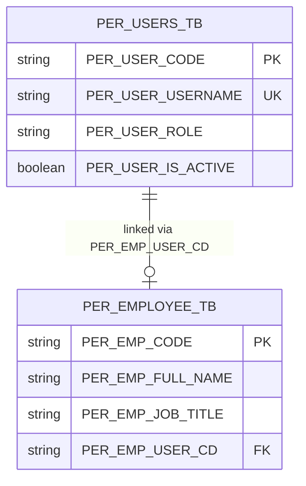
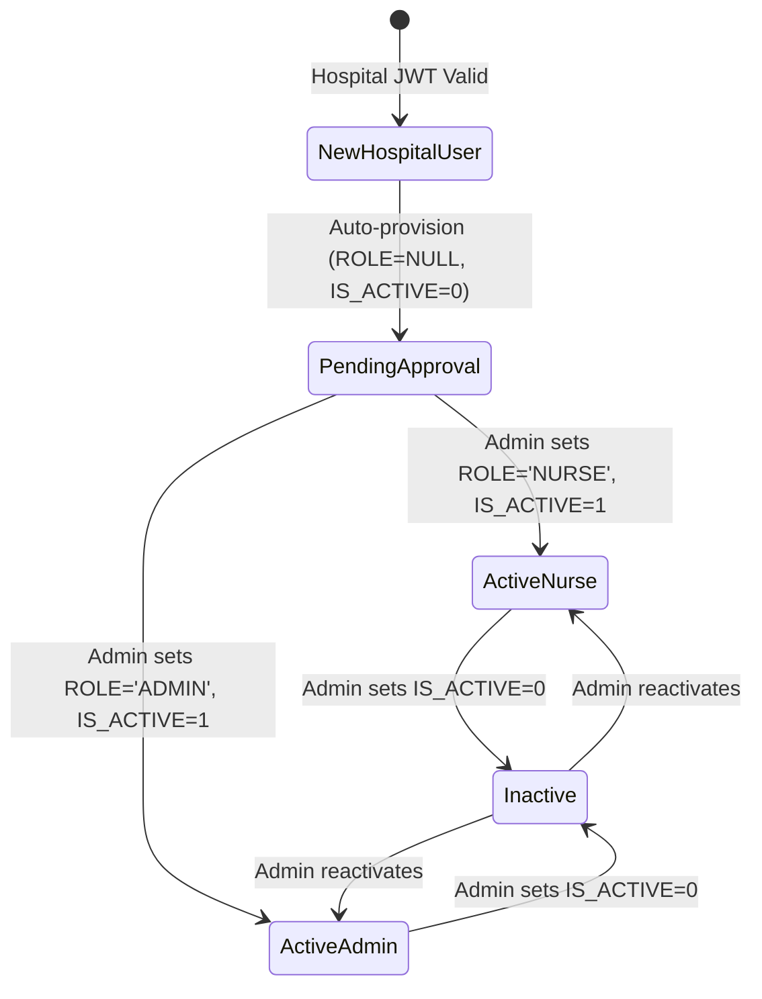

# Data Model & Schema Specification: Phase 3 — Auth & RBAC

**Branch**: `003-auth-rbac` | **Date**: 2026-09-22 | **Spec**: [spec.md](file:///e:/wamp64/www/wccms/specs/003-auth-rbac/spec.md)

This document defines the database tables, Eloquent models, attributes, constraints, and relationships for Phase 3 Auth & RBAC in WCCMS.

---

## 1. Entity Definitions & Database Mapping

### 1.1 `per_users_tb` (User Account)

- **Database Table**: `per_users_tb`
- **Model Class**: `App\Models\User`
- **Primary Key**: `PER_USER_CODE` (`char(36)` UUID, `$incrementing = false`, `$keyType = 'string'`)
- **Timestamps**: Disabled (`$timestamps = false`)

| Column Name | Data Type | Nullable | Default | Description & Constraints |
|---|---|---|---|---|
| `PER_USER_CODE` | `char(36)` | **NO** | *UUID* | Primary key (UUID string) |
| `PER_USER_USERNAME` | `varchar(50)` | **NO** | *None* | Unique resolved hospital username identifier |
| `PER_USER_PASSWORD` | `varchar(255)` | YES | `NULL` | Retained for schema stability; **unused by application** |
| `PER_USER_ROLE` | `enum('ADMIN','NURSE')` | **YES** | `NULL` | WCCMS-local role. `NULL` upon auto-provisioning until assigned by Admin |
| `PER_USER_IS_ACTIVE` | `tinyint(1)` | **NO** | `0` | WCCMS local access flag (1 = Active, 0 = Inactive / Pending Approval) |

#### Validation & Cast Rules
```php
protected $casts = [
    'PER_USER_IS_ACTIVE' => 'boolean',
];

public static array $rules = [
    'PER_USER_USERNAME'  => 'required|string|max:50|unique:per_users_tb,PER_USER_USERNAME',
    'PER_USER_ROLE'      => 'nullable|in:ADMIN,NURSE',
    'PER_USER_IS_ACTIVE' => 'boolean',
];
```

---

### 1.2 `per_employee_tb` (Employee Profile)

- **Database Table**: `per_employee_tb`
- **Model Class**: `App\Models\Employee`
- **Primary Key**: `PER_EMP_CODE` (`char(36)` UUID, `$incrementing = false`, `$keyType = 'string'`)
- **Timestamps**: Disabled (`$timestamps = false`)

| Column Name | Data Type | Nullable | Default | Description & Constraints |
|---|---|---|---|---|
| `PER_EMP_CODE` | `char(36)` | **NO** | *UUID* | Primary key (UUID string) |
| `PER_EMP_FULL_NAME` | `varchar(150)` | **NO** | *None* | Full Arabic employee name displayed in UI header |
| `PER_EMP_JOB_TITLE` | `varchar(100)` | YES | `NULL` | Arabic job title (e.g. "ممرض جروح", "طبيب مسؤول") |
| `PER_EMP_USER_CD` | `char(36)` | **YES** | `NULL` | Foreign Key to `per_users_tb.PER_USER_CODE` (unique link) |

#### Validation & Cast Rules
```php
public static array $rules = [
    'PER_EMP_FULL_NAME' => 'required|string|max:150',
    'PER_EMP_JOB_TITLE' => 'nullable|string|max:100',
    'PER_EMP_USER_CD'   => 'nullable|string|size:36|exists:per_users_tb,PER_USER_CODE|unique:per_employee_tb,PER_EMP_USER_CD',
];
```

---

## 2. Entity Relationships



### Model Eloquent Methods

#### `User.php`
```php
public function employee(): HasOne
{
    return $this->hasOne(Employee::class, 'PER_EMP_USER_CD', 'PER_USER_CODE');
}

public function isAdmin(): bool
{
    return $this->PER_USER_ROLE === 'ADMIN';
}

public function isNurse(): bool
{
    return $this->PER_USER_ROLE === 'NURSE';
}
```

#### `Employee.php`
```php
public function user(): BelongsTo
{
    return $this->belongsTo(User::class, 'PER_EMP_USER_CD', 'PER_USER_CODE');
}
```

---

## 3. Account Lifecycle & State Transitions



| Initial State | Event / Trigger | Target State | Allowed Actor | Resulting Side Effects |
|---|---|---|---|---|
| Non-existent | First valid JWT request | `PendingApproval` | System (Middleware) | Record inserted in `per_users_tb` (`ROLE=NULL`, `ACTIVE=0`); 403 response in Arabic |
| `PendingApproval` | Admin updates role & status | `ActiveNurse` / `ActiveAdmin` | `ADMIN` user | `PER_USER_ROLE` updated; `PER_USER_IS_ACTIVE` set to 1; User can access system |
| `ActiveNurse` / `ActiveAdmin` | Admin deactivates | `Inactive` | `ADMIN` user | `PER_USER_IS_ACTIVE` set to 0; Existing sessions terminated; Access blocked |
