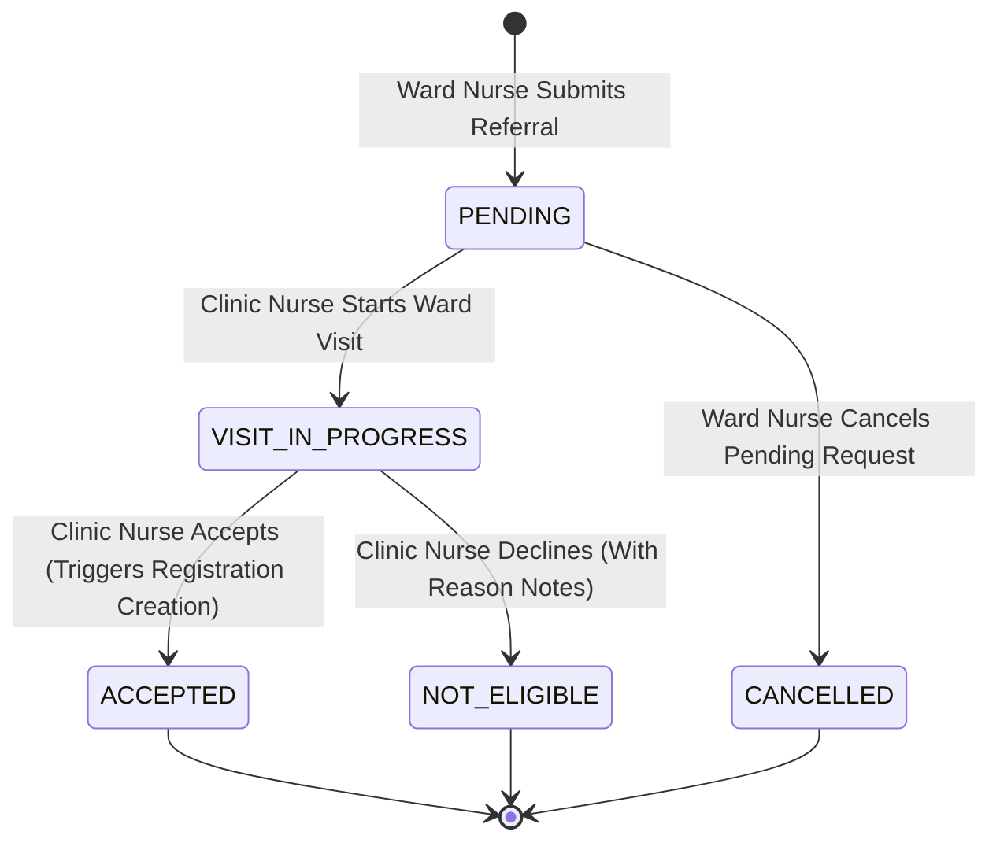

# Phase 1 Data Model: Phase 4 — Registration Requests

**Feature**: [`spec.md`](spec.md) | **Branch**: `004-registration-requests`

## Entity Definitions & Relationships

### 1. `WcRequestReg` (`wc_request_reg_tb`)

Represents a patient referral request submitted by a hospital ward nurse to the Wound Care Clinic.

| Column | Type | Nullable | Description / Constraints |
|--------|------|----------|---------------------------|
| `WC_REQ_CODE` | CHAR(36) | No | Primary Key (UUID string) |
| `WC_REQ_PATIENT_CD` | CHAR(36) | No | FK to `mr_patient_tb.MR_PAT_CODE` |
| `WC_REQ_PAT_NAME_SNAPSHOT` | VARCHAR(150) | No | Immutable patient full name snapshot |
| `WC_REQ_PAT_ID_SNAPSHOT` | VARCHAR(50) | No | Immutable patient National ID snapshot |
| `WC_REQ_PAT_PHONE_SNAPSHOT` | VARCHAR(30) | Yes | Immutable patient phone snapshot |
| `WC_REQ_NURSE_CD` | CHAR(36) | No | FK to `per_employee_tb.PER_EMP_CODE` (requesting ward nurse) |
| `WC_REQ_ENTRY_USER_CD` | CHAR(36) | No | FK to `per_users_tb.PER_USER_CODE` (authenticated data-entry user) |
| `WC_REQ_REVIEWED_BY_CD` | CHAR(36) | Yes | FK to `per_employee_tb.PER_EMP_CODE` (clinic nurse handling visit/outcome) |
| `WC_REQ_STATUS` | VARCHAR(20) | No | Status: `PENDING`, `VISIT_IN_PROGRESS`, `ACCEPTED`, `NOT_ELIGIBLE`, `CANCELLED` (Default: `PENDING`) |
| `WC_REQ_NOTES` | TEXT | Yes | Referral reason, ward details, or ineligible justification notes |
| `WC_REQ_CREATED_AT` | DATETIME | No | Referral submission timestamp |

**Relationships**:
- `patient()`: `belongsTo(MrPatient::class, 'WC_REQ_PATIENT_CD', 'MR_PAT_CODE')`
- `nurse()`: `belongsTo(PerEmployee::class, 'WC_REQ_NURSE_CD', 'PER_EMP_CODE')`
- `entryUser()`: `belongsTo(PerUser::class, 'WC_REQ_ENTRY_USER_CD', 'PER_USER_CODE')`
- `reviewer()`: `belongsTo(PerEmployee::class, 'WC_REQ_REVIEWED_BY_CD', 'PER_EMP_CODE')`
- `registration()`: `hasOne(WcRegistration::class, 'WC_REG_REQUEST_CD', 'WC_REQ_CODE')`

---

### 2. `WcRegistration` (`wc_registration_tb`)

Represents an active clinical registration instantiated upon accepting a referral request.

| Column | Type | Nullable | Description / Constraints |
|--------|------|----------|---------------------------|
| `WC_REG_CODE` | CHAR(36) | No | Primary Key (UUID string) |
| `WC_REG_REQUEST_CD` | CHAR(36) | No | FK to `wc_request_reg_tb.WC_REQ_CODE` |
| `WC_REG_PATIENT_CD` | CHAR(36) | No | FK to `mr_patient_tb.MR_PAT_CODE` |
| `WC_REG_DEPARTMENT_CD` | CHAR(36) | No | FK to `wc_department_tb.WC_DEPT_CODE` (Default Wound Care Clinic department) |
| `WC_REG_PROCEDURE_CD` | CHAR(36) | Yes | FK to `wc_procedure_tb.WC_PROC_CODE` |
| `WC_REG_PMH_NOTES` | TEXT | Yes | Clinical notes |
| `WC_REG_DATE` | DATETIME | No | Registration activation timestamp |
| `WC_REG_NURSE_CD` | CHAR(36) | No | FK to `per_employee_tb.PER_EMP_CODE` (clinic nurse) |
| `WC_REG_ENTRY_USER_CD` | CHAR(36) | No | FK to `per_users_tb.PER_USER_CODE` (entry user) |
| `WC_REG_STATUS` | VARCHAR(20) | No | Status: `ACTIVE`, `DISCHARGED` (Default: `ACTIVE`) |

---

## State Machine & Transitions



### State Rules & Validation Constraints

1. **Duplicate Prevention**:
   - Patient MUST NOT have an existing request in status `PENDING` or `VISIT_IN_PROGRESS`.
   - Patient MUST NOT have an existing registration in status `ACTIVE`.
2. **Actor vs. Data-Entry Enforcement**:
   - `WC_REQ_NURSE_CD` records the employee performing the ward referral.
   - `WC_REQ_ENTRY_USER_CD` records the authenticated system user code.
   - `WC_REQ_REVIEWED_BY_CD` records the clinic nurse employee conducting the visit / intake.
3. **Cancellation Rule**:
   - A request can ONLY be cancelled when `WC_REQ_STATUS == 'PENDING'`.
   - Only the submitting nurse or an ADMIN can perform cancellation.

---

## In-Database Stored Procedure Specification (Constitution Principle II & VI)

### `sp_accept_registration_request`

- **Parameters**:
  - `p_request_code` (CHAR(36))
  - `p_clinic_nurse_cd` (CHAR(36))
  - `p_entry_user_cd` (CHAR(36))
- **Execution Logic**:
  1. Verify request exists and `WC_REQ_STATUS IN ('PENDING', 'VISIT_IN_PROGRESS')`.
  2. Update `wc_request_reg_tb`:
     - Set `WC_REQ_STATUS = 'ACCEPTED'`
     - Set `WC_REQ_REVIEWED_BY_CD = p_clinic_nurse_cd`
  3. Resolve default Wound Care Clinic department code `v_dept_code` from `wc_department_tb` (where `WC_DEPT_IS_ACTIVE = 1` limit 1).
  4. Generate new UUID `v_reg_code`.
  5. Insert record into `wc_registration_tb`:
     ```sql
     INSERT INTO wc_registration_tb (
         WC_REG_CODE, WC_REG_REQUEST_CD, WC_REG_PATIENT_CD, WC_REG_DEPARTMENT_CD,
         WC_REG_DATE, WC_REG_NURSE_CD, WC_REG_ENTRY_USER_CD, WC_REG_STATUS
     ) VALUES (
         v_reg_code, p_request_code, v_patient_code, v_dept_code,
         NOW(), p_clinic_nurse_cd, p_entry_user_cd, 'ACTIVE'
     );
     ```
