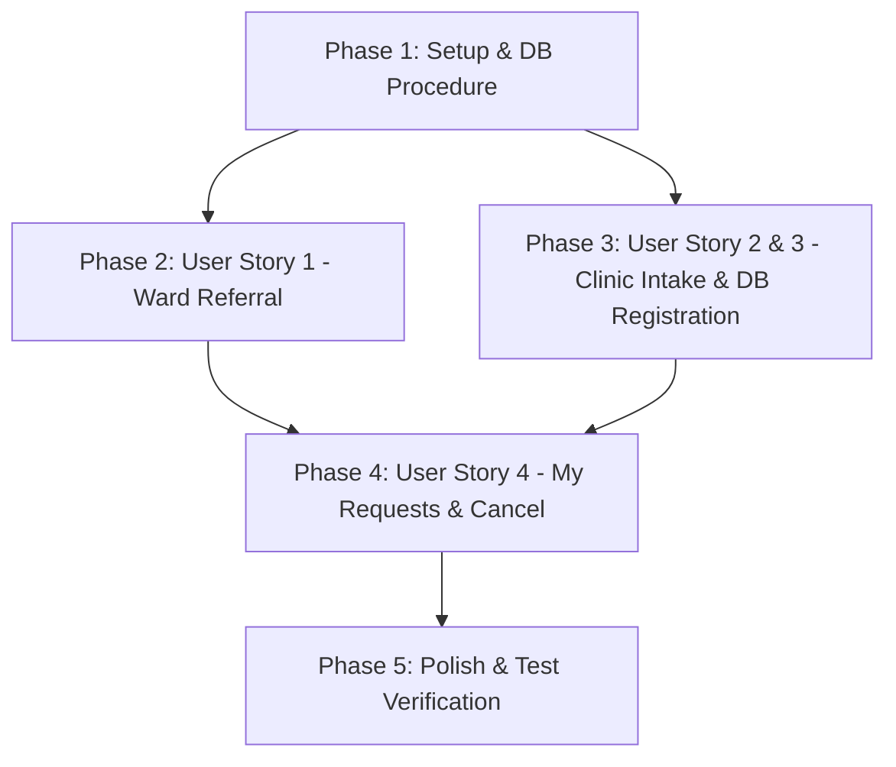

# Tasks: Phase 4 — Registration Requests

**Feature Branch**: `004-registration-requests` | **Date**: 2026-09-23 | **Spec**: [`spec.md`](spec.md) | **Plan**: [`plan.md`](plan.md)

---

## Phase 1: Setup & Foundational

**Purpose**: Project readiness and core service & database procedure dependencies.

- [x] T001 [P] Verify feature models `WcRequestReg` in `app/Models/WcRequestReg.php` and `WcRegistration` in `app/Models/WcRegistration.php`
- [x] T002 [P] Create `HospitalPatientSyncServiceInterface` and mock implementation `HospitalPatientSyncService` in `app/Services/HospitalPatientSyncService.php`
- [x] T003 Create stored procedure migration `database/migrations/2026_09_23_000001_create_sp_accept_registration_request.php` implementing `sp_accept_registration_request` in MySQL/Oracle compatible SQL

---

## Phase 2: User Story 1 - Ward Referral & Patient Search (Priority: P1) 🌟 MVP

**Goal**: Enable hospital ward nurses to search for patients by National ID or name, view admission details, and submit referral requests (`wc_request_reg_tb`).

**Independent Test**: Login as ward nurse, search patient by National ID, fill referral form, submit, and verify `PENDING` request record created in `wc_request_reg_tb`.

- [x] T004 [P] [US1] Create `StoreRegistrationRequest` Form Request with validation rules (required `patient_code`, `attending_nurse_code`, optional `notes`, duplicate check blocking if patient has pending request or active registration) in `app/Http/Requests/StoreRegistrationRequest.php`
- [x] T005 [P] [US1] Implement patient search API endpoint `searchPatient` (`GET /requests/search-patient`) in `app/Http/Controllers/RegistrationRequestController.php`
- [x] T006 [US1] Implement referral submission method `store` (`POST /requests`) setting `WC_REQ_STATUS = 'PENDING'`, snapshot attributes, `WC_REQ_NURSE_CD`, and `WC_REQ_ENTRY_USER_CD` in `app/Http/Controllers/RegistrationRequestController.php`
- [x] T007 [P] [US1] Build patient search and referral submission Blade view in `resources/views/requests/create.blade.php` with full Arabic RTL layout
- [x] T008 [US1] Register web routes `GET /requests/search-patient` and `POST /requests` in `routes/web.php`
- [x] T009 [US1] Write feature tests for patient search and referral submission in `tests/Feature/WardReferralSubmissionTest.php`

---

## Phase 3: User Story 2 & 3 - Clinic Queue, Ward Visit & In-Database Registration (Priority: P1) 🌟 MVP

**Goal**: Enable clinic nurses to view incoming requests, conduct ward visits (`VISIT_IN_PROGRESS`), decline (`NOT_ELIGIBLE`), or accept (`ACCEPTED`) patients, executing the in-database registration creation procedure (`wc_registration_tb`).

**Independent Test**: Login as clinic nurse, select pending referral, click Start Visit (`VISIT_IN_PROGRESS`), accept patient (`ACCEPTED`), and verify `wc_registration_tb` record created with `WC_REG_STATUS = 'ACTIVE'` and default clinic department.

- [x] T010 [P] [US2] Create `MarkIneligibleRequest` Form Request with validation rules (required `reason` text) in `app/Http/Requests/MarkIneligibleRequest.php`
- [x] T011 [P] [US2] Implement clinic incoming queue method `index` (`GET /requests`) listing pending referrals in `app/Http/Controllers/RegistrationRequestController.php`
- [x] T012 [US2] Implement referral detail view method `show` (`GET /requests/{request}`) in `app/Http/Controllers/RegistrationRequestController.php`
- [x] T013 [US2] Implement `startVisit` method (`POST /requests/{request}/visit`) updating status to `VISIT_IN_PROGRESS` and setting `WC_REQ_REVIEWED_BY_CD` in `app/Http/Controllers/RegistrationRequestController.php`
- [x] T014 [US2] Implement `markIneligible` method (`POST /requests/{request}/ineligible`) updating status to `NOT_ELIGIBLE` with justification notes in `app/Http/Controllers/RegistrationRequestController.php`
- [x] T015 [US3] Implement `accept` method (`POST /requests/{request}/accept`) calling database stored procedure `sp_accept_registration_request` in `app/Http/Controllers/RegistrationRequestController.php`
- [x] T016 [P] [US2] Build incoming requests queue Blade view in `resources/views/requests/index.blade.php` with Arabic RTL table and status badges
- [x] T017 [P] [US2] Build referral details & visit intake Blade view in `resources/views/requests/show.blade.php`
- [x] T018 [US2] Register web routes `GET /requests`, `GET /requests/{request}`, `POST /requests/{request}/visit`, `POST /requests/{request}/accept`, and `POST /requests/{request}/ineligible` in `routes/web.php`
- [x] T019 [US3] Write feature tests for clinic queue, ward visit, and automated registration creation in `tests/Feature/ClinicIntakeAndRegistrationTest.php`

---

## Phase 4: User Story 4 - Referral Tracking & Cancellation ("My Requests") (Priority: P2)

**Goal**: Allow submitting ward nurses to track their submitted referrals and cancel any `PENDING` request.

**Independent Test**: Login as ward nurse, navigate to "My Requests", click Cancel on a pending request, and confirm status updates to `CANCELLED`.

- [x] T020 [P] [US4] Implement `myRequests` method (`GET /requests/my`) filtering by authenticated user code in `app/Http/Controllers/RegistrationRequestController.php`
- [x] T021 [US4] Implement `cancel` method (`POST /requests/{request}/cancel`) updating status to `CANCELLED` when request is `PENDING` in `app/Http/Controllers/RegistrationRequestController.php`
- [x] T022 [P] [US4] Build "My Requests" Blade view in `resources/views/requests/my_requests.blade.php` with Arabic RTL status badges and conditional cancel button
- [x] T023 [US4] Register web routes `GET /requests/my` and `POST /requests/{request}/cancel` in `routes/web.php`
- [x] T024 [US4] Write feature tests for my requests listing and request cancellation in `tests/Feature/MyRequestsAndCancellationTest.php`

---

## Phase 5: Polish & Cross-Cutting Concerns

**Purpose**: Formatting, Arabic RTL compliance, and full test suite verification.

- [x] T025 [P] Run Pint code formatter (`vendor/bin/pint --format agent`) on all modified PHP files
- [x] T026 [P] Audit all Blade templates in `resources/views/requests/` for 100% Arabic string localization and RTL layout compliance
- [x] T027 Run full PHPUnit test suite (`php artisan test`) to confirm all tests pass cleanly

---

## Dependencies & Execution Order

---

## Parallel Execution Opportunities

- **Setup Phase**: T001, T002 can run in parallel.
- **User Story 1**: T004 (Form Request) and T007 (Blade View) can run in parallel.
- **User Story 2 & 3**: T010 (Form Request), T011 (Controller index), T016 (Queue View), and T017 (Show View) can run in parallel.
- **User Story 4**: T020 (My Requests Controller) and T022 (Blade View) can run in parallel.

---

## Implementation Strategy (MVP First)

1. **Step 1**: Complete Phase 1 (Setup & `sp_accept_registration_request` DB Procedure).
2. **Step 2**: Complete Phase 2 (User Story 1 — Ward Referral Submission).
3. **Step 3**: Complete Phase 3 (User Story 2 & 3 — Clinic Intake Queue & Registration).
4. **MVP Validation**: Test end-to-end flow from referral submission to clinic acceptance and automated registration creation.
5. **Step 4**: Complete Phase 4 (User Story 4 — My Requests & Cancel).
6. **Step 5**: Run Pint formatting and test suite verification.
