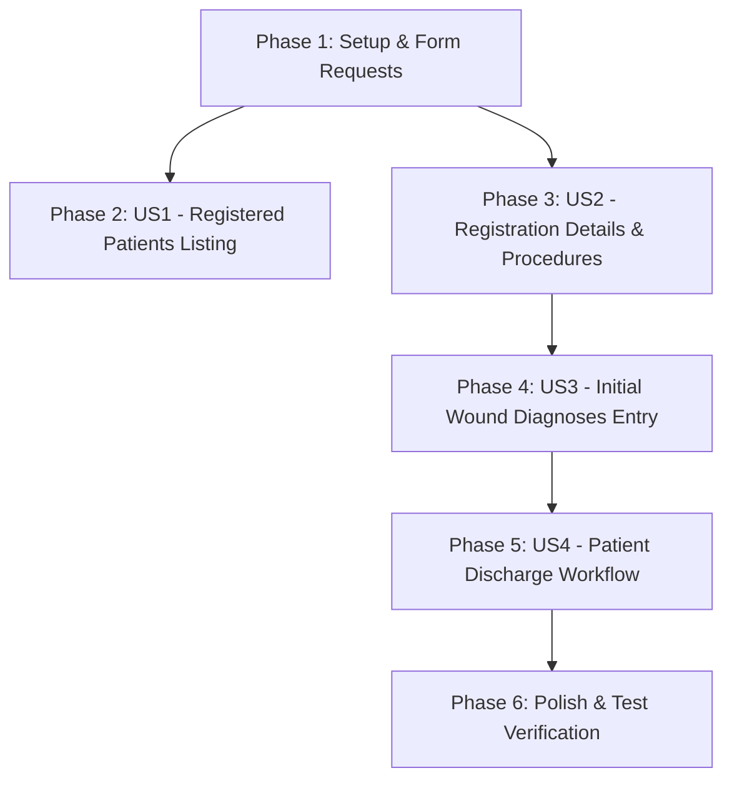

# Tasks: Phase 5 — Registration & Diagnosis

**Feature Branch**: `005-registration-diagnosis` | **Date**: 2026-09-26 | **Spec**: [`spec.md`](spec.md) | **Plan**: [`plan.md`](plan.md)

---

## Phase 1: Setup & Foundational

**Purpose**: Verify DB-First Eloquent models and build Form Request validation classes.

- [x] T001 [P] Verify feature models `WcRegistration` in `app/Models/WcRegistration.php` and `WcRegDiagnosis` in `app/Models/WcRegDiagnosis.php` for DB-First PKs (`WC_REG_CODE`, `WC_RDIAG_CODE`) and Eloquent relationships
- [x] T002 [P] Create Form Request `UpdateRegistrationRequest` in `app/Http/Requests/UpdateRegistrationRequest.php` validating `procedure_code` (nullable UUID existing in `wc_procedure_tb`) and `pmh_notes` (nullable string)
- [x] T003 [P] Create Form Request `StoreWoundDiagnosisRequest` in `app/Http/Requests/StoreWoundDiagnosisRequest.php` validating `wound_type_code` (required UUID), `diagnosis_code` (required UUID), `dressing_code` (required UUID), `medication_code` (required UUID), and `clinical_nurse_code` (required UUID existing in `per_employee_tb`)
- [x] T004 [P] Create Form Request `DischargeRegistrationRequest` in `app/Http/Requests/DischargeRegistrationRequest.php` validating `discharging_nurse_code` (required UUID existing in `per_employee_tb`)

---

## Phase 2: User Story 1 — Registered Patients Listing & Filtering (Priority: P1) 🎯 MVP

**Goal**: Render registered patients listing (`/registrations`) with status filter tabs (`ACTIVE` vs `DISCHARGED`) and real-time patient search.

**Independent Test**: Navigate to `/registrations`, switch status tabs, and filter by patient National ID or name.

- [x] T005 [P] [US1] Create feature test `tests/Feature/RegistrationListingTest.php` testing active/discharged listing and search filtering
- [x] T006 [US1] Implement `index` method (`GET /registrations`) in `app/Http/Controllers/RegistrationController.php` with status filtering (`WC_REG_STATUS`) and patient search
- [x] T007 [P] [US1] Build registered patients listing Blade view `resources/views/registrations/index.blade.php` adapted from `pre-views/registered-patients.html` with Arabic RTL layout, status badges, and filter tabs
- [x] T008 [US1] Register route `GET /registrations` in `routes/web.php` guarded by `hospital.jwt` middleware

---

## Phase 3: User Story 2 — Registration Details & Clinical Procedure Management (Priority: P1) 🎯 MVP

**Goal**: Display `/registrations/{registration}` details page, update initial procedure (`WC_REG_PROCEDURE_CD`), and edit PMH notes (`WC_REG_PMH_NOTES`).

**Independent Test**: Open registration page, update procedure and PMH notes, submit, and verify data persists in `wc_registration_tb`.

- [x] T009 [P] [US2] Create feature test `tests/Feature/RegistrationDetailsTest.php` testing registration details view and procedure/PMH update
- [x] T010 [US2] Implement `show` method (`GET /registrations/{registration}`) in `app/Http/Controllers/RegistrationController.php` loading relationships (`patient`, `department`, `procedure`, `registeringNurse`, `diagnoses`)
- [x] T011 [US2] Implement `update` method (`PUT /registrations/{registration}`) in `app/Http/Controllers/RegistrationController.php` persisting procedure and PMH notes
- [x] T012 [P] [US2] Build registration details Blade view `resources/views/registrations/show.blade.php` adapted from `pre-views/complete-registration.html` with Arabic RTL form controls and master option selects
- [x] T013 [US2] Register routes `GET /registrations/{registration}` and `PUT /registrations/{registration}` in `routes/web.php`

---

## Phase 4: User Story 3 — Initial Wound Diagnosis & Treatment Plan Entry (Priority: P1) 🎯 MVP

**Goal**: Add multiple initial wound diagnoses (`wc_reg_diagnosis_tb`) per registration with dual audit tracking (`WC_RDIAG_CLINICAL_EMP_CD` vs `WC_RDIAG_ENTRY_USER_CD`).

**Independent Test**: Add a wound diagnosis to an active registration and verify record persists in `wc_reg_diagnosis_tb` with both nurse and user IDs.

- [x] T014 [P] [US3] Create feature test `tests/Feature/WoundDiagnosisCreationTest.php` testing wound diagnosis creation and dual audit tracking
- [x] T015 [US3] Implement `storeDiagnosis` method (`POST /registrations/{registration}/diagnoses`) in `app/Http/Controllers/RegistrationController.php` setting `WC_RDIAG_ENTRY_USER_CD = Auth::user()->PER_USER_CODE`
- [x] T016 [P] [US3] Create wound diagnosis modal partial `resources/views/registrations/partials/wound_diagnosis_modal.blade.php` with dropdowns for wound types, diagnoses, dressings, medications, and examining nurses
- [x] T017 [US3] Register route `POST /registrations/{registration}/diagnoses` in `routes/web.php`

---

## Phase 5: User Story 4 — Patient Discharge Workflow & Audit (Priority: P2)

**Goal**: Allow clinic nurse to discharge patient (`WC_REG_STATUS = 'DISCHARGED'`), recording timestamp and discharging nurse.

**Independent Test**: Submit discharge action on active registration and verify status becomes `DISCHARGED` with recorded datetime and nurse code.

- [x] T018 [P] [US4] Create feature test `tests/Feature/RegistrationDischargeTest.php` testing discharge workflow and status restrictions
- [x] T019 [US4] Implement `discharge` method (`POST /registrations/{registration}/discharge`) in `app/Http/Controllers/RegistrationController.php` setting `WC_REG_STATUS = 'DISCHARGED'`, `WC_REG_DISCHARGED_AT = NOW()`, and `WC_REG_DISCHARGED_BY_EMP_CD`
- [x] T020 [P] [US4] Create discharge modal partial `resources/views/registrations/partials/discharge_modal.blade.php` and update `show.blade.php` to disable additions when discharged
- [x] T021 [US4] Register route `POST /registrations/{registration}/discharge` in `routes/web.php`

---

## Phase 6: Polish & Cross-Cutting Concerns

**Purpose**: Code formatting, Arabic RTL compliance, and full test suite verification.

- [x] T022 [P] Format all modified PHP files using `vendor/bin/pint --format agent`
- [x] T023 [P] Audit all Blade templates in `resources/views/registrations/` for 100% Arabic string localization and RTL layout compliance
- [x] T024 Run full PHPUnit test suite (`php artisan test --compact`) confirming 100% pass rate

---

## Dependencies & Execution Order

---

## Parallel Execution Opportunities

- **Setup Phase**: T001, T002, T003, T004 can run in parallel.
- **User Story 1**: T005 (Feature test) and T007 (Blade view) can run in parallel.
- **User Story 2**: T009 (Feature test) and T012 (Blade view) can run in parallel.
- **User Story 3**: T014 (Feature test) and T016 (Modal partial) can run in parallel.
- **User Story 4**: T018 (Feature test) and T020 (Modal partial) can run in parallel.

---

## Implementation Strategy (MVP First)

1. **Step 1**: Complete Phase 1 (Form Requests validation classes).
2. **Step 2**: Complete Phase 2 (User Story 1 — Registered Patients Listing).
3. **Step 3**: Complete Phase 3 (User Story 2 — Registration Details & Procedure update).
4. **Step 4**: Complete Phase 4 (User Story 3 — Initial Wound Diagnosis Entry).
5. **MVP Validation**: Test end-to-end flow from viewing registration to updating details and adding wound diagnoses.
6. **Step 5**: Complete Phase 5 (User Story 4 — Patient Discharge Workflow).
7. **Step 6**: Run Pint formatting and test suite verification.
