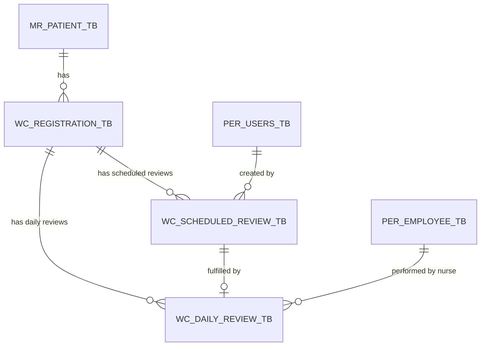

# Phase 1: Data Model — Scheduled Reviews & Appointments Management

## Feature Branch: `007-scheduled-reviews`

---

## 1. Schema & Entities Overview

### Entity 1: `WcScheduledReview` (`wc_scheduled_review_tb`)
Represents a scheduled follow-up appointment for a patient's active registration.

| Column | Type | Constraints | Description |
|---|---|---|---|
| `WC_SREV_CODE` | CHAR(36) | Primary Key (UUID) | Unique appointment identifier |
| `WC_SREV_REGISTRATION_CD` | CHAR(36) | Foreign Key -> `wc_registration_tb.WC_REG_CODE` | Linked active patient registration |
| `WC_SREV_CREATED_BY_CD` | CHAR(36) | Foreign Key -> `per_users_tb.PER_USER_CODE`, Nullable | Data-entry user who recorded the scheduled review |
| `WC_SREV_SCHEDULED_DATE` | DATETIME | NOT NULL | Date and time of scheduled review |
| `WC_SREV_VISIT_SERIAL` | INT | Default 1 | Sequential visit number for the registration |
| `WC_SREV_STATUS` | VARCHAR(20) | Default 'PENDING', Indexed | Status: `PENDING`, `COMPLETED`, `CANCELLED` |
| `WC_SREV_NOTES` | TEXT | Nullable | Notes, instructions, or cancellation reason |
| `WC_SREV_CREATED_ON` | DATETIME | Nullable | Timestamp when appointment was created |
| `WC_SREV_COMPLETED_ON` | DATETIME | Nullable | Timestamp when appointment was completed/fulfilled |

---

### Entity 2: `WcDailyReview` (`wc_daily_review_tb`)
Represents a daily clinical review visit.

| Column | Type | Constraints | Description |
|---|---|---|---|
| `WC_DREV_CODE` | CHAR(36) | Primary Key (UUID) | Unique review visit identifier |
| `WC_DREV_REGISTRATION_CD` | CHAR(36) | Foreign Key -> `wc_registration_tb.WC_REG_CODE` | Linked patient registration |
| `WC_DREV_SCHEDULED_REVIEW_CD` | CHAR(36) | Foreign Key -> `wc_scheduled_review_tb.WC_SREV_CODE`, Nullable | Linked scheduled review appointment |
| `WC_DREV_VISIT_DATE` | DATETIME | NOT NULL | Timestamp of daily review visit |
| `WC_DREV_NURSE_CD` | CHAR(36) | Foreign Key -> `per_employee_tb.PER_EMP_CODE` | Clinical nurse performing visit |
| `WC_DREV_ENTRY_USER_CD` | CHAR(36) | Foreign Key -> `per_users_tb.PER_USER_CODE` | Data-entry user recording visit |
| `WC_DREV_OVERALL_STATUS` | VARCHAR(30) | NOT NULL | Overall visit status (e.g. `IMPROVED_SCHEDULED`) |
| `WC_DREV_GENERAL_NOTES` | TEXT | Nullable | General clinical observations |

---

## 2. Model Relationships



- **WcScheduledReview**:
  - `belongsTo(WcRegistration, 'WC_SREV_REGISTRATION_CD', 'WC_REG_CODE')`
  - `belongsTo(PerUser, 'WC_SREV_CREATED_BY_CD', 'PER_USER_CODE')`
  - `hasOne(WcDailyReview, 'WC_DREV_SCHEDULED_REVIEW_CD', 'WC_SREV_CODE')`

- **WcDailyReview**:
  - `belongsTo(WcScheduledReview, 'WC_DREV_SCHEDULED_REVIEW_CD', 'WC_SREV_CODE')`
  - `belongsTo(WcRegistration, 'WC_DREV_REGISTRATION_CD', 'WC_REG_CODE')`
  - `belongsTo(PerEmployee, 'WC_DREV_NURSE_CD', 'PER_EMP_CODE')`
  - `belongsTo(PerUser, 'WC_DREV_ENTRY_USER_CD', 'PER_USER_CODE')`

---

## 3. State Transitions & Lifecycle

### Status State Machine (`WC_SREV_STATUS`)

```
      [ Daily Review Outcome: IMPROVED_SCHEDULED ]
                         │
                         ▼
                    ┌──────────┐
                    │ PENDING  │◄────── Reschedule (update date)
                    └────┬─────┘
                         │
        ┌────────────────┼────────────────┐
        │                │                │
        ▼                ▼                ▼
 [ Staff Fulfill ]  [ Staff Cancel ] [ Patient Re-Registered ]
        │                │                │
        ▼                ▼                ▼
  ┌───────────┐    ┌───────────┐    ┌─────────────────┐
  │ COMPLETED │    │ CANCELLED │    │  HARD DELETED   │
  └───────────┘    └───────────┘    └─────────────────┘
```

1. **PENDING**: Initial state upon appointment creation. Stays `PENDING` indefinitely, even if `WC_SREV_SCHEDULED_DATE` is in the past.
2. **COMPLETED**: Transitioned automatically when a `WcDailyReview` is created referencing `WC_SREV_CODE`. `WC_SREV_COMPLETED_ON` is populated.
3. **CANCELLED**: Transitioned manually when staff cancel the appointment. `WC_SREV_NOTES` records optional cancellation reason.
4. **HARD DELETED**: Wiped directly from database (`DELETE FROM wc_scheduled_review_tb`) when a new active registration is accepted for the patient.

---

## 4. Validation & Business Rules

1. **Fulfillment Validation**:
   - Appointment MUST be in `PENDING` status to launch a daily review visit. If status is `COMPLETED` or `CANCELLED`, system blocks fulfillment and returns an error.
2. **Reschedule Validation**:
   - `scheduled_date` MUST be a valid date/time format.
   - Appointment MUST be in `PENDING` status to be rescheduled.
3. **Cancellation Validation**:
   - Appointment MUST be in `PENDING` status to be cancelled.
   - Optional `notes` max length 1000 characters.
4. **Re-Registration Cleanup Validation**:
   - When `RegistrationRequestController@accept` or `WcRegistration::create` runs, all `PENDING` scheduled reviews belonging to previous registrations for the same `WC_REG_PATIENT_CD` MUST be deleted atomically within the registration creation transaction.
